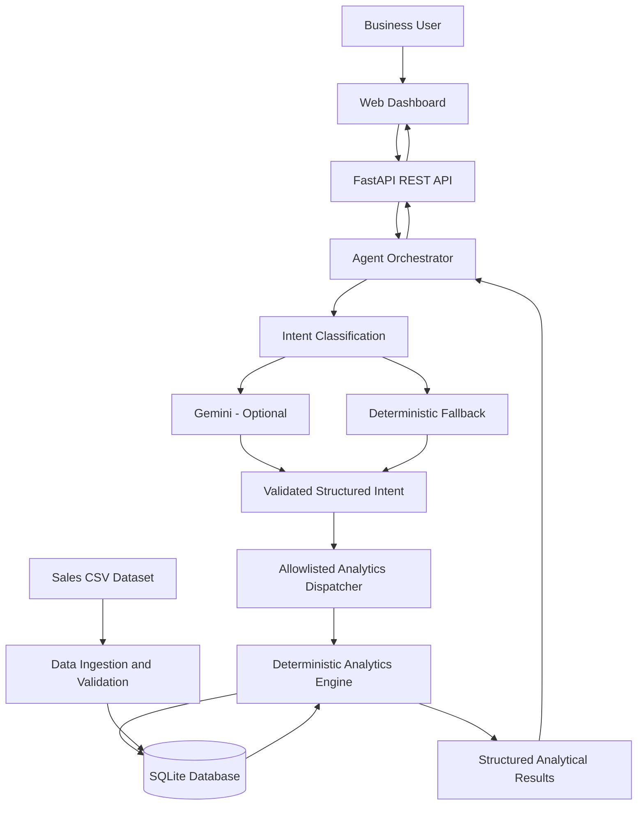

# RSG Sales Intelligence AI Assistant

**Official AI-Assisted Development Challenge — Graduate Engineer Trainee (GET) Selection**

A full-stack Business Intelligence Assistant that answers natural-language questions about sales transactions using a deterministic SQLite analytics engine, a FastAPI backend, and optional Gemini-powered intent classification.

<p align="center">

**[Live Dashboard](https://rsg-sales-intelligence-ai.onrender.com) · [API Documentation](https://rsg-sales-intelligence-ai.onrender.com/docs) · [ReDoc](https://rsg-sales-intelligence-ai.onrender.com/redoc)**

</p>

---

## 1. Project Overview

The RSG Sales Intelligence AI Assistant enables business stakeholders to explore structured sales data through natural-language questions and interactive visualizations.

The system combines AI-assisted intent classification with deterministic analytical functions to produce traceable, data-grounded numerical results.

### Key Features

- **Natural-language querying:** Ask business questions without writing SQL.
- **Vectorless RAG architecture:** Converts questions into structured analytical intents instead of relying on vector similarity for numerical calculations.
- **Deterministic analytics:** Calculates revenue, product rankings, monthly trends, regional performance, and month-to-month changes using SQLite.
- **Optional Gemini integration:** Uses the Google Gen AI SDK for intent classification when configured, with a deterministic fallback when unavailable.
- **Data-quality controls:** Preserves source records and flags transactions that cannot be included in top-line revenue.
- **Interactive dashboard:** Displays KPI summaries, data tables, and a monthly revenue chart.
- **REST API:** Provides natural-language query, health-check, and direct analytics endpoints.
- **Automated testing:** Includes 78 tests covering the agent, analytics, database, and API layers.

## 2. Live Application

| Resource | Link |
|---|---|
| Interactive Dashboard | [Open Dashboard](https://rsg-sales-intelligence-ai.onrender.com) |
| Swagger API Documentation | [Open `/docs`](https://rsg-sales-intelligence-ai.onrender.com/docs) |
| ReDoc API Documentation | [Open `/redoc`](https://rsg-sales-intelligence-ai.onrender.com/redoc) |
| Health Check | [Check API Health](https://rsg-sales-intelligence-ai.onrender.com/api/health) |
| OpenAPI Specification | [View OpenAPI JSON](https://rsg-sales-intelligence-ai.onrender.com/openapi.json) |

**Deployment status:** The deployed health endpoint has been verified to report 51 total records, 49 valid revenue records, and a connected database.

> The application is hosted on Render's free instance. After periods of inactivity, the service may take longer to respond while it starts up.

## 3. Supported Business Questions

The assistant supports five core analytical questions and their natural-language paraphrases.

### 1. What is the total revenue?

Returns net revenue, gross revenue, discounts, units sold, valid transaction count, and category/channel breakdowns.

### 2. Which product generated the highest revenue?

Ranks products by net revenue and provides supporting metrics, including units sold and transaction count. The leading product in the current dataset is **Monitor**, with net revenue of ₹473,000.

### 3. What is the monthly revenue trend?

Returns monthly revenue, transaction and unit counts, month-over-month changes, and the peak and lowest revenue months.

### 4. Which region generated the highest sales?

Reports regional performance by both net revenue and units sold. In the current dataset, **South** leads both measures, with ₹411,200 in net revenue and 182 units sold.

### 5. How did revenue change between two months?

Compares two months using baseline revenue, target revenue, absolute change, and percentage change.

For example, revenue increased from ₹240,700 in April 2026 to ₹318,500 in May 2026, an increase of ₹77,800 or 32.32%.

## 4. System Architecture

The application follows a layered architecture that separates user interaction, intent classification, analytical execution, and data storage.



### Component Responsibilities

| Component | Responsibility |
|---|---|
| **Frontend** | Collects questions and presents answers, KPI cards, tables, and charts. |
| **FastAPI** | Exposes REST endpoints, validates incoming requests, and returns structured responses. |
| **Agent orchestrator** | Coordinates intent classification, validation, analytics execution, and answer construction. |
| **Gemini integration** | Optionally classifies natural-language questions into structured intents. |
| **Deterministic fallback** | Recognizes supported question patterns when Gemini is unavailable or not configured. |
| **Analytics engine** | Executes approved calculations for the five business questions. |
| **SQLite database** | Stores sales transactions and data-quality information used by the analytics engine. |
| **CSV ingestion pipeline** | Validates and imports source records while preserving records that require auditing. |

### Query Processing Flow

1. A user submits a question through the dashboard.
2. FastAPI validates the request and passes it to the agent.
3. The agent classifies the question using Gemini when configured, or the deterministic fallback otherwise.
4. The structured intent and its parameters are validated.
5. An allowlisted analytics function executes the corresponding database query.
6. The agent constructs a response using the analytical results.
7. FastAPI returns the answer and supporting data to the dashboard.

**Design principle:** AI assists with understanding the question; deterministic code and database queries calculate the numerical results.

## 5. Technology Stack

| Layer | Technologies |
|---|---|
| Programming Language | Python 3.12 |
| Backend | FastAPI, Uvicorn |
| Database | SQLite 3 |
| Data Processing | Python standard library, pandas |
| AI Integration | Google Gen AI SDK, Gemini 2.5 Flash |
| Validation | Pydantic |
| Frontend | HTML5, CSS3, Vanilla JavaScript |
| Visualization | SVG charts and dashboard tables |
| Testing | pytest, FastAPI TestClient, HTTPX |
| Version Control | Git and GitHub |
| Deployment | Render Web Service |

## 6. Business Rules and Financial Data Integrity

All top-line financial metrics follow explicit business rules.

### Revenue Formulas

**Gross revenue**

\[
\text{Gross Revenue} = \text{Quantity} \times \text{Unit Price}
\]

**Net revenue**

\[
\text{Net Revenue} = \text{Gross Revenue} - \text{Discount Amount}
\]

### Transaction Eligibility

- **Completed transactions:** Included in top-line revenue when they satisfy the data-quality rules.
- **Returned transaction TXN0033:** Excluded from revenue calculations. Its gross amount is ₹19,000.
- **Missing unit price — TXN0051:** Preserved for auditing, flagged as `MISSING_UNIT_PRICE`, and excluded from revenue calculations.
- **Zero quantity — TXN0034:** Preserved as a valid zero-revenue transaction.

### Verified Dataset Summary

| Metric | Value |
|---|---:|
| Total source records | 51 |
| Valid revenue records | 49 |
| Flagged or excluded records | 2 |
| Gross revenue | ₹1,443,700 |
| Total discounts | ₹4,500 |
| Net revenue | ₹1,439,200 |
| Units sold | 633 |

### Data Integrity Principles

- Invalid records are not silently discarded from the source audit trail.
- Missing financial values are not fabricated.
- Revenue calculations are performed by deterministic analytical functions.
- Month-over-month percentages use the previous month's revenue as the baseline.
- User questions are routed to allowlisted analytical functions; arbitrary SQL generation is not used.

## 7. Repository Structure

```text
srinidhi_rsg/
├── .env.example
├── .gitignore
├── README.md
├── requirements.txt
├── pytest.ini
├── ai_bi_assistant_sales_data - GET.csv
├── data/
│   └── sales_data.csv
├── docs/
│   ├── AGENT_SPEC.md
│   ├── ANALYTICS_SPEC.md
│   └── API_SPEC.md
├── frontend/
│   ├── index.html
│   ├── styles.css
│   └── app.js
├── src/
│   ├── __init__.py
│   ├── config.py
│   ├── db.py
│   ├── import_data.py
│   ├── analytics.py
│   ├── agent.py
│   └── main.py
└── tests/
    ├── __init__.py
    ├── conftest.py
    ├── test_db.py
    ├── test_analytics.py
    ├── test_agent.py
    └── test_api.py
```

The SQLite database is generated locally and is not committed to Git. The application initializes its database and imports the source dataset during startup.

## 8. Local Setup and Installation

### Prerequisites

- Git
- Python 3.12
- Windows, macOS, or Linux

### Step 1: Clone the Repository

```bash
git clone https://github.com/GattuSrinidhi/rsg-sales-intelligence-ai.git
cd rsg-sales-intelligence-ai
```

### Step 2: Create a Virtual Environment

**Windows — PowerShell**

```powershell
py -3.12 -m venv .venv
.\.venv\Scripts\Activate.ps1
```

**Windows — Git Bash**

```bash
py -3.12 -m venv .venv
source .venv/Scripts/activate
```

### Step 3: Install Dependencies

```bash
python -m pip install -r requirements.txt
```

### Step 4: Configure Gemini (Optional)

The application supports deterministic fallback operation without a Gemini API key.

To enable Gemini intent classification:

1. Copy the environment template.
2. Add your API key to the local `.env` file.
3. Keep the `.env` file private and never commit it.

**PowerShell**

```powershell
Copy-Item .env.example .env
```

Configure the values in `.env` according to `.env.example`:

```env
GEMINI_API_KEY=your_api_key_here
GEMINI_MODEL=gemini-2.5-flash
```

Get an API key from [Google AI Studio](https://aistudio.google.com/).

### Step 5: Initialize the Database and Import Data

```bash
python -m src.import_data
```

The ingestion pipeline validates the dataset and imports its records into SQLite. On application startup, the application also runs the configured ingestion routine.

### Step 6: Start the Application

```bash
python -m uvicorn src.main:app --host 127.0.0.1 --port 8000 --reload
```

If port 8000 is occupied, use port 8001 instead.

### Step 7: Open the Application

- Dashboard: [http://127.0.0.1:8000](http://127.0.0.1:8000)
- Swagger API Docs: [http://127.0.0.1:8000/docs](http://127.0.0.1:8000/docs)
- ReDoc: [http://127.0.0.1:8000/redoc](http://127.0.0.1:8000/redoc)
- Health Check: [http://127.0.0.1:8000/api/health](http://127.0.0.1:8000/api/health)

## 9. API Reference

| Method | Endpoint | Description |
|---|---|---|
| `GET` | `/api/health` | Reports application and database health. |
| `POST` | `/api/query` | Answers a natural-language sales question. |
| `GET` | `/api/analytics/total-revenue` | Returns net and gross revenue metrics. |
| `GET` | `/api/analytics/top-product` | Ranks products by revenue or units. |
| `GET` | `/api/analytics/monthly-trend` | Returns monthly revenue trends. |
| `GET` | `/api/analytics/top-region` | Ranks regions by revenue or units. |
| `GET` | `/api/analytics/revenue-delta` | Compares revenue between two months. |

### Example Natural-Language Query

**Request**

```http
POST /api/query
Content-Type: application/json
```

```json
{
  "question": "What is the total revenue?"
}
```

The response includes the success status, original question, detected intent, answer, supporting data, and execution trace.

For request schemas, response models, and interactive endpoint testing, see the [Swagger API documentation](https://rsg-sales-intelligence-ai.onrender.com/docs).

## 10. Automated Testing

The project includes **78 automated tests** covering database integrity, ingestion behavior, analytical calculations, intent classification, fallback handling, API validation, and response contracts.

Run the full test suite:

```bash
python -m pytest -v
```

The verified local test result is **78 passed**. The test suite mocks external Gemini calls so that it can run without a live API key.

## 11. Deployment

The application is deployed on Render as a Python web service.

**Production dashboard:**  
https://rsg-sales-intelligence-ai.onrender.com

**Build command**

```bash
pip install -r requirements.txt
```

**Start command**

```bash
uvicorn src.main:app --host 0.0.0.0 --port $PORT
```

The application initializes its database and imports the CSV during startup. The deployment health endpoint has been verified against the expected dataset counts.

Because the application uses SQLite, its database file should be treated as local or instance storage unless persistent storage is explicitly configured. For production workloads requiring durable data across instance replacement, configure persistent storage or migrate to a managed database.

## 12. Security and Configuration

- API keys belong in environment variables, not source code.
- `.env`, virtual environments, caches, and generated database files should remain excluded from Git.
- Database access is routed through predefined analytics functions.
- User input is validated before processing.
- Analytical queries use controlled database operations rather than unrestricted AI-generated SQL.

## 13. Future Improvements

- Add more analytical intents and date-range comparisons.
- Expand regression tests for edge cases and data-quality scenarios.
- Improve dashboard accessibility and responsive visualization.
- Add persistent production storage and deployment monitoring.
- Introduce role-based access controls if the application is used with sensitive business data.

---

**Built for the RSG Graduate Engineer Trainee AI-Assisted Development Challenge.**

**Repository:** [GattuSrinidhi/rsg-sales-intelligence-ai](https://github.com/GattuSrinidhi/rsg-sales-intelligence-ai)  
**Live Demo:** [RSG Sales Intelligence AI Assistant](https://rsg-sales-intelligence-ai.onrender.com)
